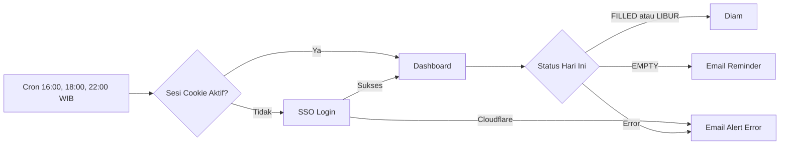

# Monev MagangHub Cron Reminder Bot

Bot Python + Playwright untuk mengecek apakah laporan harian di `monev.maganghub.kemnaker.go.id` sudah diisi atau belum.
Berjalan otomatis di cloud menggunakan **GitHub Actions** (laptop tidak perlu hidup) 3x sehari pada hari kerja (**16:00, 18:00, dan 22:00 WIB**).

## Cara Kerja Bot

1. Berjalan setiap Senin–Jumat pukul `16:00`, `18:00`, dan `22:00` WIB (`09:00`, `11:00`, `15:00` UTC).
2. Login ke `monev.maganghub.kemnaker.go.id` melalui portal SSO SIAPkerja (`account.kemnaker.go.id`).
3. Mengecek status hari ini dari endpoint `/api/v1/users/me/home` serta cross-check ke halaman `/dashboard` dan `/dashboard/riwayat?date=YYYY-MM-DD&view=detail`.
4. **Aturan Notifikasi:**
   - **Sudah diisi / Hari libur:** Diam (tidak kirim email).
   - **Belum diisi:** Kirim email pengingat dengan tautan langsung ke halaman pengisian hari itu.
   - **Terjadi Error (gagal login, web down, struktur berubah):** Kirim email alert error + simpan screenshot ke GitHub Actions Artifacts.

## Flow Sistem



## Setup di GitHub (Gratis, Tanpa Laptop Hidup)

1. **Buat repository GitHub baru bertipe `Private`** lalu push folder ini ke repo tersebut.
2. **Buat API Key di Resend:**
   - Masuk ke dashboard Resend → **API Keys** → **Create API Key** (permission: `Sending access`).
   - Jika belum memiliki domain terverifikasi di Resend, pengirim default otomatis memakai `Monev Bot <onboarding@resend.dev>` — dengan catatan `NOTIFY_EMAIL` harus sama dengan email yang terdaftar di akun Resend kamu.
   - Jika sudah verifikasi domain sendiri di Resend, kamu bisa menambahkan secret opsional `RESEND_FROM` (misal `Monev Bot <noreply@domainkamu.com>`).
3. **Tambahkan GitHub Repository Secrets** di menu **Settings → Secrets and variables → Actions → New repository secret**:
   - `MONEV_EMAIL`: Email akun SIAPkerja / Kemnaker kamu
   - `MONEV_PASSWORD`: Password akun SIAPkerja / Kemnaker kamu
   - `RESEND_API_KEY`: API key Resend (`re_...`)
   - `NOTIFY_EMAIL`: Email tujuan penerima notifikasi
   - `MONEV_STORAGE_STATE`: *(Disarankan untuk GitHub Actions)* Isi `artifacts/storage_state.json` hasil login lokal agar server GitHub langsung masuk ke `/dashboard` tanpa memicu verifikasi Cloudflare di `account.kemnaker.go.id`. Bisa diunggah cepat lewat:
     ```powershell
     Get-Content -Raw artifacts/storage_state.json | gh secret set MONEV_STORAGE_STATE
     ```
   - *(Opsional)* `RESEND_FROM`: Alamat pengirim jika pakai domain custom terverifikasi di Resend
   - *(Opsional, alternatif tanpa Resend)* `SMTP_USERNAME`, `SMTP_PASSWORD`, `SMTP_HOST`, `SMTP_PORT`
4. **Tes Manual Pertama Kali:**
   - Buka tab **Actions** → pilih workflow **Monev Daily Report Check** → klik **Run workflow**.
   - Cek log eksekusi untuk memastikan login SSO berhasil dan email Resend terkirim.

## Jalankan di Lokal (Opsional untuk Testing)

```bash
python -m venv .venv
.venv\Scripts\activate
pip install -r requirements.txt
playwright install chromium

copy .env.example .env
# Isi .env dengan kredensial kamu, lalu jalankan test tanpa kirim email:
python -m src.main --dry-run --force
```

## Maintenance

Bot berjalan otomatis tanpa laptop hidup, dengan perawatan ringan berikut:

1. **Perbarui `MONEV_STORAGE_STATE` jika sesi kedaluwarsa:**
   - Jika menerima email `[Monev Bot ERROR]` bertuliskan sesi kedaluwarsa / verifikasi keamanan Cloudflare di `account.kemnaker.go.id`, perbarui cookie sesi dari laptopmu (IP Indonesia) lalu unggah lagi ke GitHub Secret:
     ```powershell
     # Opsional: hapus sesi lama jika ingin memaksa login ulang dari awal
     Remove-Item -ErrorAction SilentlyContinue artifacts\storage_state.json

     .\.venv\Scripts\python.exe -m src.main --dry-run --force
     Get-Content -Raw artifacts\storage_state.json | gh secret set MONEV_STORAGE_STATE
     ```
2. **Aturan 60 hari tanpa commit di GitHub Actions:**
   - GitHub otomatis menonaktifkan jadwal `cron` jika repository tidak memiliki commit baru selama 60 hari berturut-turut. Jika muncul notifikasi dari GitHub, buka tab **Actions** → **Monev Daily Report Check** → klik **Enable workflow**.
3. **Diagnosa error:**
   - Setiap kegagalan di GitHub Actions menyimpan screenshot halaman terakhir ke artifact `monev-debug-artifacts` (tersimpan 7 hari) di halaman run yang gagal.

## Catatan Penting

- **Pergeseran Jam Cron GitHub:** GitHub Actions cron gratis kadang mundur 5–20 menit di jam sibuk. Kalau ingin eksekusi tepat waktu di menit `:00`, kamu bisa pakai layanan gratis seperti `cron-job.org` untuk men-trigger endpoint `workflow_dispatch` GitHub API.
- **Geo-blocking:** Jika server luar negeri (GitHub runner) sewaktu-waktu diblokir oleh firewall instansi, bot akan mengirim email alert error dan solusi alternatifnya adalah menjalankan script Python yang sama di VPS lokal Indonesia dengan `crontab`.
