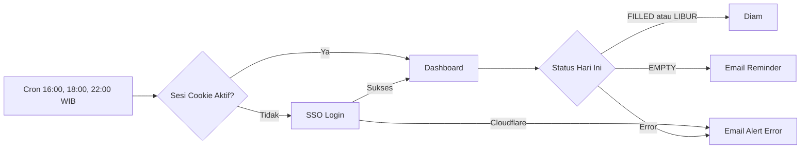

# Monev MagangHub Cron Reminder Bot

Bot Python + Playwright untuk mengecek apakah laporan harian di `monev.maganghub.kemnaker.go.id` sudah diisi atau belum.  
Berjalan otomatis di cloud menggunakan **GitHub Actions** dan penjadwalan **`cron-job.org`** (laptop tidak perlu hidup) 3x sehari pada hari kerja (**16:00, 18:00, dan 22:00 WIB**).

## Cara Kerja Bot

1. Dipicu tepat waktu oleh `cron-job.org` via GitHub API (`workflow_dispatch`) setiap Senin–Jumat pukul `16:00`, `18:00`, dan `22:00` WIB.
2. Login ke `monev.maganghub.kemnaker.go.id` melalui portal SSO SIAPkerja (`account.kemnaker.go.id`) menggunakan sesi cookie tersimpan.
3. Mengecek status hari ini dari endpoint `/api/v1/users/me/home` serta cross-check ke halaman `/dashboard` dan `/dashboard/riwayat?date=YYYY-MM-DD&view=detail`.
4. **Aturan Notifikasi:**
   - **Sudah diisi / Hari libur:** Diam (tidak kirim email).
   - **Belum diisi:** Kirim email pengingat dengan tautan langsung ke halaman pengisian hari itu.
   - **Terjadi Error (gagal login, web down, struktur berubah):** Kirim email alert error + simpan screenshot ke GitHub Actions Artifacts.

## Flow Sistem



## Prasyarat

- Akun **GitHub** (gratis).
- Akun **Resend** ([resend.com](https://resend.com), gratis) untuk kirim email notifikasi *(atau SMTP Gmail sebagai alternatif)*.
- Akun **`cron-job.org`** ([cron-job.org](https://cron-job.org), gratis) untuk pemicu jadwal tepat waktu.
- **Python 3.11+** di laptop/PC (hanya dipakai sekali di awal untuk mengambil cookie sesi login dari IP Indonesia).

---

## Panduan Setup (Gratis, Tanpa Laptop Hidup)

### 1. Siapkan Repository GitHub (`Private`)

1. Buat repository baru di GitHub dengan visibilitas **`Private`** (misal nama repo: `monev-cron-agent`). Jangan centang *Initialize with README*.
2. Push isi folder proyek ini ke repository tersebut (pastikan nama branch utama adalah `main`):
   ```bash
   git init -b main
   git add .
   git commit -m "Initial commit"
   git remote add origin https://github.com/<GITHUB_USERNAME>/<REPO_NAME>.git
   git push -u origin main
   ```
   *(Jika mendapat kode ini dari link repo GitHub, kamu juga bisa memakai menu **+ → Import repository** di GitHub dan pilih **Private**.)*

### 2. Buat API Key di Resend

1. Daftar / login ke [resend.com](https://resend.com).
2. Masuk ke menu **API Keys** → **Create API Key** → pilih permission **`Sending access`** → salin API key-nya (`re_...`).
3. **Catatan pengirim email:**
   - Jika belum punya domain sendiri di Resend, bot otomatis memakai `Monev Bot <onboarding@resend.dev>`. Dengan mode ini, **`NOTIFY_EMAIL` wajib sama dengan email akun Resend kamu**.
   - Jika sudah verifikasi domain sendiri di Resend, kamu bisa mengisi secret opsional `RESEND_FROM` (misal `Monev Bot <noreply@domainkamu.com>`).

### 3. Ambil Cookie Sesi Awal di Lokal *(Sangat Disarankan)*

Server GitHub Actions berada di luar negeri sehingga login langsung ke `account.kemnaker.go.id` sering terkena verifikasi Cloudflare. Dengan login sekali di laptopmu (IP Indonesia), bot akan membuat file `artifacts/storage_state.json` yang bisa dipakai GitHub Actions untuk langsung masuk ke `/dashboard`.

**Windows (PowerShell / CMD):**
```powershell
python -m venv .venv
.venv\Scripts\activate
pip install -r requirements.txt
playwright install chromium

copy .env.example .env
```

**macOS / Linux:**
```bash
python3 -m venv .venv
source .venv/bin/activate
pip install -r requirements.txt
playwright install chromium

cp .env.example .env
```

Setelah itu:
1. Buka file `.env` lalu isi minimal `MONEV_EMAIL`, `MONEV_PASSWORD`, `NOTIFY_EMAIL`, dan `RESEND_API_KEY`.
2. Jalankan perintah berikut untuk login dan tes tanpa mengirim email sungguhan:
   ```bash
   python -m src.main --dry-run --force
   ```
3. Jika berhasil, status laporan hari ini akan muncul di terminal dan file **`artifacts/storage_state.json`** otomatis terbuat.

### 4. Buat Fine-grained Personal Access Token (PAT) di GitHub

Token ini dipakai untuk 2 hal: agar workflow bisa otomatis memperbarui sesi cookie yang dirotasi server, dan agar `cron-job.org` bisa memicu workflow. *(Boleh pakai 1 token dengan kedua izin di bawah, atau pisah jadi 2 token berbeda jika ingin lebih ketat.)*

1. Buka GitHub → **Settings** (profil kanan atas) → **Developer settings** → **Personal access tokens** → **Fine-grained tokens** → **Generate new token**.
2. Isi **Token name** (misal `monev-cron-agent`).
3. **Expiration:** Pilih durasi yang panjang (misal **1 year** / Custom) — jangan biarkan default 30 hari agar bot tidak tiba-tiba berhenti bulan depan.
4. **Repository access:** Pilih **Only select repositories** → pilih repository `monev-cron-agent` milikmu.
5. **Permissions → Repository permissions:**
   - **Actions:** `Read and write`
   - **Secrets:** `Read and write`
6. Klik **Generate token** lalu **langsung salin token-nya (`github_pat_...`)** karena tidak bisa dilihat lagi setelah halaman ditutup.

### 5. Tambahkan GitHub Repository Secrets

Buka repository GitHub milikmu → **Settings** → **Secrets and variables** → **Actions** → **New repository secret**, lalu tambahkan secret berikut:

| Nama Secret | Wajib? | Isi |
| --- | --- | --- |
| `MONEV_EMAIL` | Wajib | Email akun SIAPkerja / Kemnaker kamu |
| `MONEV_PASSWORD` | Wajib | Password akun SIAPkerja / Kemnaker kamu |
| `RESEND_API_KEY` | Wajib* | API key Resend (`re_...`) dari Langkah 2 |
| `NOTIFY_EMAIL` | Wajib | Email tujuan penerima notifikasi |
| `MONEV_STORAGE_STATE` | Sangat disarankan | Seluruh isi file `artifacts/storage_state.json` dari Langkah 3 |
| `GH_SECRETS_TOKEN` | Wajib (agar sesi awet) | Token GitHub (`github_pat_...`) dari Langkah 4 |
| `RESEND_FROM` | Opsional | Alamat pengirim jika pakai domain custom terverifikasi di Resend |
| `SMTP_USERNAME`, `SMTP_PASSWORD`, `SMTP_HOST`, `SMTP_PORT` | Opsional* | Alternatif kirim email lewat SMTP jika tidak memakai Resend |

**Cara mengisi `MONEV_STORAGE_STATE`:**
- **Cara Manual (paling mudah):** Buka file `artifacts/storage_state.json` dengan Notepad / VS Code → pilih semua (`Ctrl+A`) → salin (`Ctrl+C`) → tempel ke kolom **Secret** saat membuat `MONEV_STORAGE_STATE` di GitHub.
- **Cara Cepat (jika sudah install [GitHub CLI `gh`](https://cli.github.com/)):**
  ```powershell
  Get-Content -Raw artifacts/storage_state.json | gh secret set MONEV_STORAGE_STATE
  ```

### 6. Tes Manual Pertama Kali

1. Buka tab **Actions** di repository GitHub kamu → pilih workflow **Monev Daily Report Check** → klik **Run workflow** → klik tombol hijau **Run workflow**.
2. Tunggu 1–2 menit hingga selesai, lalu buka log step **Run Monev checker**.
3. **Catatan hasil tes:**
   - Jika dijalankan di **hari kerja** dan laporan hari ini **belum diisi**, email pengingat akan masuk ke `NOTIFY_EMAIL`.
   - Jika dijalankan di **Sabtu/Minggu** atau **laporan hari ini sudah diisi**, bot memang sengaja **diam** (tidak mengirim email) — cukup pastikan log tidak error dan step *Persist rotated MONEV_STORAGE_STATE secret* berhasil.
   - Ingin tes kirim email di luar jam/hari kerja? Saat klik **Run workflow**, isi kolom **`date`** dengan tanggal hari kerja yang belum diisi (format `YYYY-MM-DD`), atau isi **`dry_run`** = `true` untuk simulasi tanpa kirim email.

### 7. Setup Penjadwalan Otomatis di `cron-job.org`

Workflow `.github/workflows/check_monev.yml` sengaja hanya memakai trigger `workflow_dispatch` (tanpa `schedule` bawaan GitHub) agar eksekusi selalu tepat waktu dan tidak dobel akibat antrean cron GitHub.

1. Daftar / login di [cron-job.org](https://cron-job.org) → **Cronjobs** → **Create cronjob**.
2. **Title:** `Monev Daily Check`
3. **URL:**
   ```text
   https://api.github.com/repos/<GITHUB_USERNAME>/<REPO_NAME>/actions/workflows/check_monev.yml/dispatches
   ```
   *(Ganti `<GITHUB_USERNAME>` dan `<REPO_NAME>` sesuai repository milikmu.)*
4. **Execution schedule → Custom:**
   - **Timezone:** `Asia/Jakarta`
   - **Hours:** `16`, `18`, `22` | **Minutes:** `0`
   - **Days of month:** `*` | **Months:** `*` | **Days of week:** `Mon`, `Tue`, `Wed`, `Thu`, `Fri`
5. **Advanced:**
   - **Request method:** `POST`
   - **Headers:**
     - `Accept`: `application/vnd.github+json`
     - `Authorization`: `Bearer <TOKEN_GITHUB_DARI_LANGKAH_4>`
     - `X-GitHub-Api-Version`: `2022-11-28`
     - `User-Agent`: `cron-job-org`
   - **Request body:** `{"ref":"main"}` *(sesuaikan jika nama branch default repo kamu bukan `main`)*
6. Klik **Create**, lalu klik **Test run**. Pastikan statusnya **`204 No Content`** dan workflow langsung muncul berjalan di tab **Actions** GitHub.

---

## Maintenance

Bot berjalan otomatis tanpa laptop hidup, dengan perawatan ringan berikut:

1. **Perbarui `MONEV_STORAGE_STATE` jika sesi kedaluwarsa:**
   Jika menerima email `[Monev Bot ERROR]` bertuliskan sesi kedaluwarsa / verifikasi Cloudflare di `account.kemnaker.go.id`, perbarui cookie sesi dari laptopmu lalu update GitHub Secret `MONEV_STORAGE_STATE`:
   ```powershell
   # Hapus sesi lama agar memaksa login ulang dari awal (Windows PowerShell)
   Remove-Item -ErrorAction SilentlyContinue artifacts\storage_state.json
   .\.venv\Scripts\python.exe -m src.main --dry-run --force

   # Unggah lewat gh CLI (atau copy-paste manual isi artifacts/storage_state.json ke GitHub Secrets)
   Get-Content -Raw artifacts\storage_state.json | gh secret set MONEV_STORAGE_STATE
   ```
2. **Perpanjang GitHub PAT saat mendekati masa kedaluwarsa:**
   Jika Fine-grained PAT sudah expired, buat token baru dengan izin yang sama (`Actions` + `Secrets` Read and write), lalu perbarui secret `GH_SECRETS_TOKEN` di GitHub dan header `Authorization` di `cron-job.org`.
3. **Diagnosa error:**
   Setiap kegagalan di GitHub Actions otomatis menyimpan screenshot halaman terakhir ke artifact `monev-debug-artifacts` (tersimpan 7 hari) di halaman run yang gagal.
4. **Alternatif tanpa `cron-job.org` (jika memakai `schedule` bawaan GitHub):**
   Jika suatu saat kamu menambahkan kembali blok `schedule:` di `.github/workflows/check_monev.yml`, ingat bahwa GitHub otomatis menonaktifkan jadwal `cron` jika repository tidak memiliki commit baru selama 60 hari berturut-turut (aktifkan lagi lewat tab **Actions** → **Enable workflow**).

## Catatan Penting

- **Kenapa Memakai `cron-job.org` (`workflow_dispatch`):** GitHub Actions `schedule` gratis sering tertunda dari puluhan menit hingga beberapa jam di jam sibuk. Menggunakan `cron-job.org` memastikan pengecekan berjalan tepat pukul `16:00`, `18:00`, dan `22:00` WIB.
- **Geo-blocking:** Jika server luar negeri (GitHub runner) sewaktu-waktu diblokir firewall instansi, bot akan mengirim email alert error; alternatifnya adalah menjalankan script Python yang sama di VPS lokal Indonesia dengan `crontab`.
